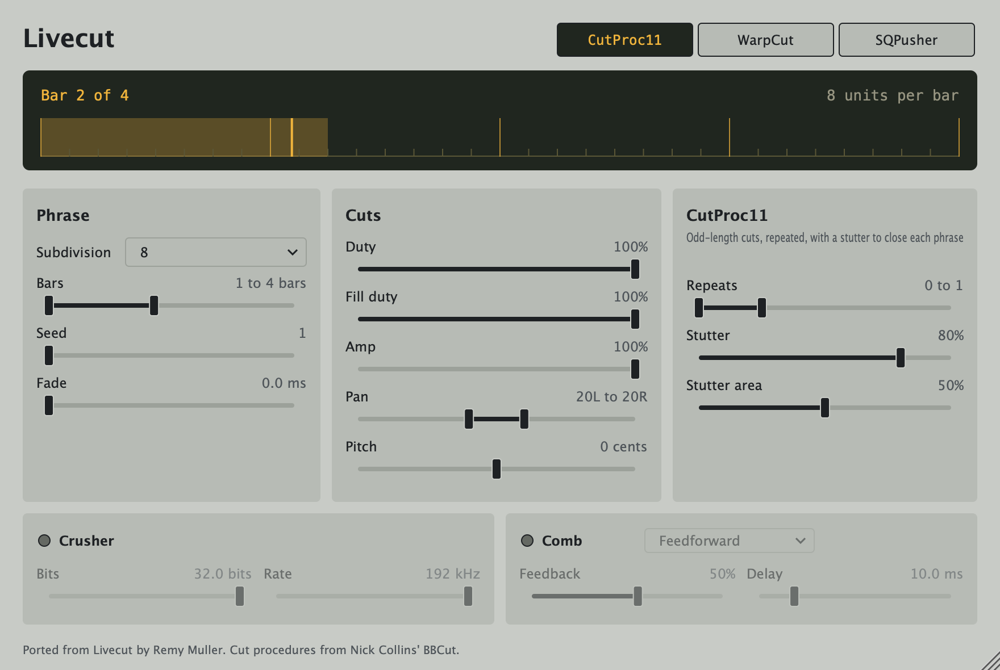

# Livecut

Livecut is a live beat slicer. Instead of chopping audio into equal slices, it
builds *phrases* out of *blocks* of *cuts* whose length and number of repeats
depend on the cutting procedure, the way a jungle or drum & bass producer would
re-edit a break. It is based on Nick Collins'
[BBCut](https://composerprogrammer.com/bbcut2.html) library for SuperCollider.

This repository is a ground-up port of the original plugin to
[JUCE 9](https://juce.com) as a native 64-bit **VST3**, **AU** and
**Standalone** app, for current DAWs (Ableton Live 12, Logic, Reaper, Bitwig…)
on Apple Silicon, Intel Macs and Windows.



The LCD across the top shows the phrase being cut: its bars and units, the
block playing now and the playhead. Livecut follows the host's transport; while
the host is stopped, audio passes through untouched.

## Status

Work in progress, landing as a stack of small pull requests:

1. **Scaffold**: CMake build, universal macOS + Windows CI, plugin validation.
2. **Engine**: a per-instance random generator and the CutProc11, WarpCut and
   SQPusher cut procedures, in a dependency-free C++20 core, with the original
   bugs fixed against BBCut's reference implementation.
3. **Player**: the live player and the cutter that follows the host's bars.
4. **Effects**: the BitCrusher and Comb, driven by the cuts.
5. **Plugin**: parameters, saved state and host-synced processing.
6. **Editor**: the user interface.
7. **Release**: signed and notarised installers.

## Building

Requirements: CMake 3.25+, and a recent Xcode (macOS) or Visual Studio (Windows).

```sh
git clone --recurse-submodules https://github.com/seandearnaley/livecut.git
cd livecut
cmake -S . -B build -DCMAKE_BUILD_TYPE=Release
cmake --build build --config Release --parallel
ctest --test-dir build --build-config Release --output-on-failure
```

The plugins end up in `build/Livecut_artefacts/Release/{VST3,AU,Standalone}`.

Useful options:

- `-DLIVECUT_COPY_PLUGIN_AFTER_BUILD=ON` installs the plugins into your user
  plug-in folders after each build.
- `-DCMAKE_OSX_ARCHITECTURES=arm64` builds for Apple Silicon only, which halves
  build times while developing. The default is a universal binary.

CI validates every build with [pluginval](https://github.com/Tracktion/pluginval)
at strictness level 10 (including Steinberg's VST3 validator) and with `auval`.

## Releases

Pushing a tag such as `v0.1.0` builds a signed, notarised macOS installer and
the Windows plug-ins, and publishes them as a GitHub release. The signing
secrets it needs are listed at the top of
[.github/workflows/release.yml](.github/workflows/release.yml). To check the
installer's layout locally without signing it:

```sh
packaging/macos/make-installer.sh build/Livecut_artefacts/Release 0.1.0 dist --unsigned
```

## Credits

- **Remy Muller** (mdsp @ Smartelectronix) wrote the original Livecut
  (2003–2004).
- **Nick Collins** designed the BBCut algorithms Livecut implements.
- Livecut-GUI 0.1, a JUCE 6 fork, exposed every parameter in a GUI.

## License

Livecut is free software: you can redistribute it and/or modify it under the
terms of the GNU General Public License as published by the Free Software
Foundation, either version 3 of the License, or (at your option) any later
version. See [LICENSE](LICENSE). The original Livecut was released under the
GPL v2 or later.

Livecut builds on [JUCE](https://github.com/juce-framework/JUCE), which is
dual-licensed under the AGPLv3 and a commercial JUCE licence; this project uses
it under the AGPLv3. Distributing a closed-source build would require a
commercial JUCE licence. The VST3 SDK is MIT-licensed.
