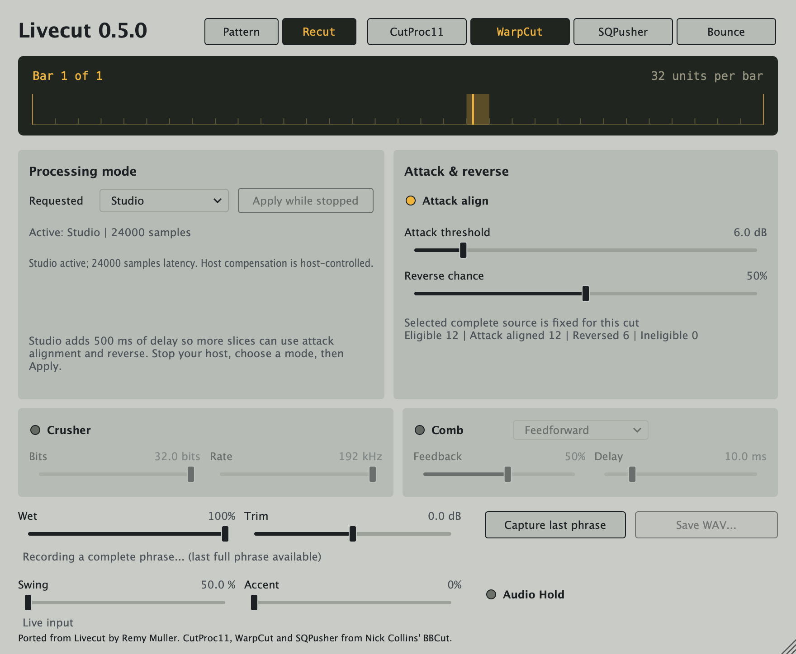
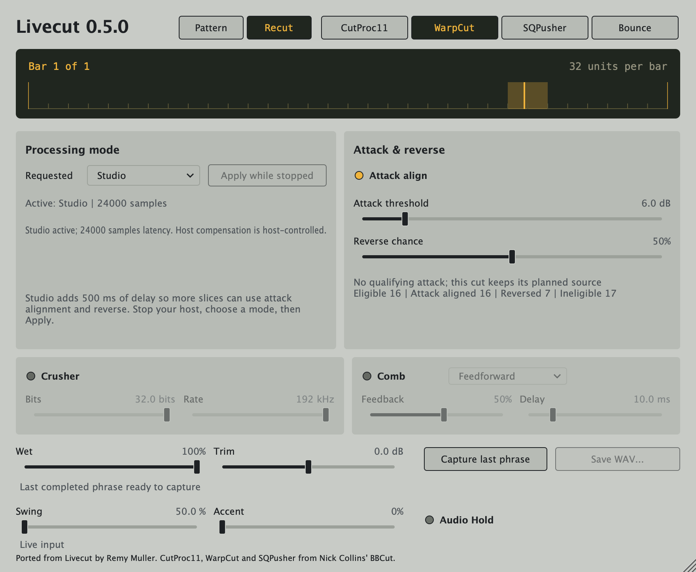

# Livecut 0.5.0 — Recut

Live stays immediate by default. Studio adds a fixed 500 ms audio delay so more
slices have enough recorded audio for attack alignment and reverse. The Recut
page groups these controls without increasing the editor's 880 × 724 footprint.
Pattern controls, Wet, Trim, Capture, Swing, Accent and Audio Hold remain available.

## Live, Studio and Apply

**Live** reports zero added processing latency. With Attack Align off and Reverse
Chance at zero, it preserves the classic cutting output and pattern randomness.
The unchanged 0.3 reference engine is compared sample for sample in tests. New instances default to Live with both
transforms off.

**Studio** delays the whole signal, including dry audio and the plug-in's unity
bypass path, by `round(0.5 × sample rate)` frames. Its first fill outputs silence
for that many frames; the ruler says it is filling the 500 ms audio buffer.
Ordinary transport loops and seeks do not repeatedly start a new physical fill.
Changing modes or preparing a fresh stream starts a new raw fill and drops
active cuts and Hold audio. A mode-only change retains the last fully completed
Capture phrase and owned export snapshots; sample-rate preparation resets the
rolling capture while existing leases/snapshots keep their own storage.

Choose the requested mode on the Recut page, stop playback in the host, then
press **Apply while stopped**. The requested choice and last published active
mode/latency are separate. Pending, unknown-transport, playing, host-change and
error messages explain why the requested configuration has not become active.
Apply dims when no change is needed or the current state prevents application.
A host's normal audio preparation may configure a saved requested mode directly.

The plug-in needs fresh audio-thread evidence that the host is stopped before
a mode-only change. If transport information is unavailable, or the host stops
sending callbacks while the last observation says playing, Apply remains pending.
Do not assume that pressing Stop has supplied a stopped callback. Preparing or
reloading the plug-in through the host can configure the saved requested mode.
Unsupported preparation rates are an explicit error with gated output; the
detector's supported processing range is 8–384 kHz.

The reported latency allows host delay compensation; it does not prove that the
host has applied compensation. Studio's monitoring delay is still audible for
live input. Host bypass/disable strategies and offline render behavior need
host-specific verification. This is not a zero-delay monitoring mode.

## Attack alignment and reverse

**Attack Align** looks for stereo-linked energy rises within an inclusive
±20 ms window around the planned source origin. A selected slice starts 2 ms
before its marker, using the same offset for both channels. Search and preroll
are rounded upward separately to whole samples. A marker too close to the start
of its transport region may therefore be unusable.

**Attack Threshold** filters candidates by their measured energy rise, from
3 to 24 dB; higher values select stronger rises. It is neither a confidence nor
a probability. The detector averages linked stereo energy in approximately 1 ms
windows, smooths it over 5 ms and keeps candidates at least 10 ms apart in a
continuous transport region. Its marker is the earliest energy maximum in the
triggering window. It can miss soft, masked or slow attacks, and sustained
modulation can trigger it. It does not classify drums or find a guaranteed
perceptual onset.

The full search window must have completed analysis before a block's candidate
set becomes ready. In Live, an early cut can be ineligible and a later cut can
become eligible as audio arrives. Once a cut starts, later analysis does not
move its source. Candidate selection considers the entire required stereo span
before choosing the nearest suitable attack; an earlier marker wins a tie.

**Reverse Chance** is the probability of reversing an eligible slice. At 100%,
every eligible slice reverses; unavailable or overlong slices remain ineligible.
With Attack Align **on**, a qualifying complete aligned source is required for
both attack alignment and reverse. If no such source exists, neither transform
applies to that cut. With Attack Align **off**, reverse can use the complete
nominal source. A fresh, incomplete or long slice is not made eligible by
raising Reverse Chance.

Direction, source span, playback rate and output-frame budget are frozen at
selection. Playback uses varispeed, so rate changes affect pitch. There is no
time-stretching to refill or extend a selected slice: if the frozen span or its
original frame budget ends before a tempo-extended cut deadline, the rest is
gated. The classic source extent is at most eight seconds. Audio from another
transport region is not substituted. Losing an already selected source is a
visible error with gated wet audio.

The status area reports eligible, aligned, reversed and ineligible counts, with
reasons such as analysis still pending, no qualifying attack, incomplete source
or a source budget limit. Counts are cumulative within a prepared stream and
reset on mode replacement or audio preparation. These automated component images show actual processed
transient input and the later sustained-input result; they are not DAW captures.

## Existing sessions and performance controls

Existing parameter IDs/order and seed behavior are retained. Missing new controls
in old states reset to Live, Attack Align off, a 6 dB threshold and zero Reverse
Chance, including recall over an already adjusted instance. Requested mode is
saved; recorded PCM, detector state, active voices, Hold audio and export
snapshots are transient. A restored Studio request may remain pending while an
existing instance is playing.

Swing and Accent retain their existing musical boundaries and deterministic
behavior. Audio Hold still captures a complete wet phrase before the global
mix/trim. Final-output Capture and stereo float WAV export still capture the
heard post-mix output. In Studio, settings, tempo, bypass and Hold requests belong
to the delayed audio's original time, rather than newer incoming controls.
Neutral output, delayed original contexts, transform selection and final-output
capture are covered by the integrated regression suite.

There is no new MIDI mode, instrument classification, machine learning or
pitch-preserving stretching in this release.

## Capacity and memory

The raw history keeps 64 seconds plus Studio's lead, search/preroll margins and
interpolation guards. Hold and Capture each retain two stereo buffers, capped
at 12,288,000 frames per slot: 64 seconds through 192 kHz, 32 seconds at 384 kHz.
Over-capacity phrases and unavailable sources have explicit status.

At 48/96/192 kHz, Studio requests about **132/264/528 MB** of prepared audio and
metadata backing storage per instance. The [memory budget](0.5.0-memory.md)
records final ARM64 type sizes, exact storage formulas, and additional export,
mode-prebuild and reprepare costs. Selected
PCM and metadata subtotals are not process RSS or a bound on host/allocator
memory. Mode Apply temporarily retains an additional raw history, timeline and
detector while preserving the existing Hold/Capture storage. Active export jobs
and capture leases can retain further snapshots or old storage.

## Downloads and validation status

Planned downloads are a universal Apple Silicon/Intel macOS installer and a
Windows x64 VST3/Standalone ZIP. The existing workflow signs/notarizes the macOS
package and leaves the Windows ZIP unsigned. **0.5.0 assets, signatures,
notarization, hashes and draft URL are PENDING verification.**

The [validation record](0.5.0-validation.md) separates local automated tests,
component images, wrapped plug-in checks and remaining CI/manual/package gates.
No manual 0.5 DAW, PDC acknowledgement, offline-render, listening or native
Capture → Save → Import result is claimed. Publication remains with the
repository owner.
